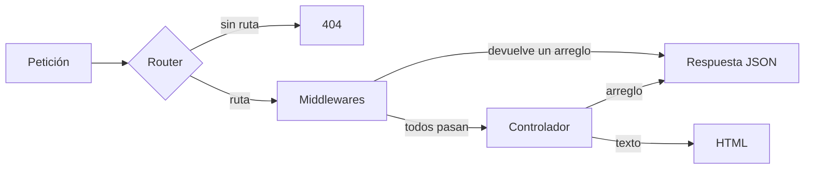

# Enrutamiento

Cada archivo de `app/routes/` declara sus rutas con `versaWYS\kernel\Router`; el kernel los carga todos al arrancar. Una petición recorre:



## Rutas

```php
<?php

declare(strict_types=1);

namespace app\routes;

use app\controllers\ProductosController;
use app\middleware\AuthMiddleware;
use versaWYS\kernel\Router;

Router::get('/admin/productos', [ProductosController::class, 'index']);
Router::post('/admin/productos', [ProductosController::class, 'crear']);
Router::put('/admin/productos/{id}', [ProductosController::class, 'editar']);
Router::patch('/admin/productos/{id}/estado', [ProductosController::class, 'estado']);
Router::delete('/admin/productos/{id}', [ProductosController::class, 'eliminar']);
```

- **CSRF:** POST, PUT, PATCH y DELETE exigen el token CSRF; el Router lo valida antes que cualquier middleware. `versaFetch` lo envía solo. Para un webhook de un tercero: `Router::post(...)->withoutCsrf()`.
- **Rutas del panel:** se declaran como `/admin/...` y se sirven bajo `admin.custom_url` (ver [Configuración](./CONFIGURATION.md)).
- **Un módulo completo** (rutas, controlador, modelo, validación y prueba) lo genera `versaCLI versaMODULE:vue:productos`. Ver [Línea de comandos](./LineaDeComandos.md#el-módulo-completo-versamodule-y-rcmd).

### Método `QUERY`

`QUERY` es el método HTTP del IETF para **consultas con cuerpo**: tan seguro e idempotente como GET, pero los filtros viajan en el cuerpo y no en la URL. Sirve para búsquedas largas y para datos que no deben quedar en los logs del servidor.

```php
Router::query('/admin/users/getUsersPaginated', [UsersController::class, 'getUsersPaginated']);
```

- No exige token CSRF, igual que GET: no cambia estado.
- El controlador lee el cuerpo (JSON o formulario) con `$request->get()` / `getAllParams()`, como en cualquier otro método.
- La respuesta incluye `Accept-Query: application/json, application/x-www-form-urlencoded`.

**`php versaCLI serve` (`php -S`) no acepta `QUERY`: responde 501.** En desarrollo, o detrás de un proxy que no lo deje pasar, envía un POST con la cabecera `X-HTTP-Method-Override: QUERY` (o el campo `_method=QUERY`):

```js
fetch('/admin/users/getUsersPaginated', {
    method: 'POST',
    headers: { 'Content-Type': 'application/json', 'X-HTTP-Method-Override': 'QUERY' },
    body: JSON.stringify({ page: 1, per_page: 20, filter: 'ana' }),
});
```

Apache y nginx suelen pasar `QUERY` a PHP-FPM sin configuración extra. Si el sitio responde 405 o 501 a `QUERY` y no al override, el servidor o un proxy lo está bloqueando.

## Parámetros de la ruta

Cada `{parámetro}` llega al método del controlador por su nombre. Con tipo `int`, un valor que no es número responde 404 sin llegar al controlador:

```php
Router::get('/admin/productos/{id}', [ProductosController::class, 'ver']);

public function ver(int $id): array   // /admin/productos/abc → 404
```

## Grupos

`Router::group(prefijo, rutas, middlewares)` antepone el prefijo y aplica los middlewares a todas sus rutas. Una ruta del grupo puede sumar los suyos, que corren después:

```php
Router::group('/admin/productos/api', function (): void {
    Router::get('/productos', [ProductosController::class, 'listar']);
    Router::delete('/productos/{id}', [ProductosController::class, 'eliminar'])
        ->middleware([[AuthMiddleware::class, 'onlyAdmin']]);
}, [
    [AuthMiddleware::class, 'checkSession'],
]);
```

Los middlewares también se pasan como tercer argumento de `Router::get(...)` o con `->middleware([...])`.

## Documentar las rutas

Las rutas se documentan con comentarios justo encima de cada `Router::...`. El framework los lee sin ejecutar el archivo y con ellos arma la documentación interactiva de `/doc` y las revisiones de `route:check`.

```php
// description: Edita un usuario existente.
// path-param name:id type:int description:ID del usuario que se va a editar
// query-param name:notificar type:bool description:Envía un correo al usuario si es true
// request-body name:name type:string description:Nombre del usuario
// request-body name:avatar type:file description:Imagen de perfil (opcional)
Router::put('/usuarios/{id}', [UsersController::class, 'editUser']);
```

| Anotación | Para qué |
|---|---|
| `// description: texto` | Qué hace la ruta. Puesta sobre un `Router::group`, la heredan las rutas del grupo que no tengan la suya. |
| `// path-param name:… type:… description:…` | Un parámetro de la URL (`{id}`). Debe existir uno por cada `{parámetro}`. |
| `// query-param name:… type:… description:…` | Un parámetro de la cadena de consulta (`?page=2`). |
| `// request-body name:… type:… description:…` | Un campo del cuerpo. Con `type:file` o `type:file[]` el probador de `/doc` muestra un selector de archivos. |

### La página `/doc`

Disponible solo con `build.debug` en `true`. Muestra los archivos de `app/routes` con su cantidad de rutas y cuántas tienen problemas, y permite ver las de un archivo o todas juntas. De cada ruta indica:

- la **URL real**: las rutas se declaran como `/admin/...`, pero se sirven bajo `admin.custom_url`;
- controlador, método y middlewares, incluidos los heredados de los grupos;
- si el Router **valida CSRF** en ella o si está exenta con `withoutCsrf()`;
- **errores** (el controlador, el método o un middleware no existe) y **avisos** de documentación faltante.

### El probador de rutas

Cada ruta trae un probador que envía la petición al propio servidor con tu sesión y el token CSRF. Las peticiones que modifican datos piden confirmación, porque actúan sobre la base de datos real.

**Petición**

- **Parámetros**: un campo por cada `path-param` y `query-param` documentado. La URL final se actualiza mientras escribes.
- **Cuerpo**: JSON, con un botón *Usar ejemplo* que arma el objeto a partir de las anotaciones `request-body` y otro para *Formatear*. Los campos `type:file` aparecen como selectores de archivo y la petición se envía como formulario.
- **Encabezados**: adicionales, uno por línea (`Nombre: valor`).
- **Copiar cURL** genera el comando equivalente, sin las cookies de sesión. **Ctrl + Enter** envía.

**Respuesta**

Muestra el estado, el tiempo y el tamaño, y elige la vista según lo que llegó:

| Respuesta | Vista inicial |
|---|---|
| JSON con `"type": "html"` (la que devuelve una página Twig en navegación SPA) | **Vista previa**: el campo `content` renderizado |
| HTML directo | **Vista previa** |
| Otro JSON | **JSON**: árbol plegable con colores |
| Imagen | **Vista previa** de la imagen |
| Texto u otro | **Raw** |

Las pestañas *JSON*, *Raw* y *Encabezados* siguen disponibles en todos los casos. La vista previa se dibuja en un marco aislado: usa los estilos del panel, pero no ejecuta scripts ni tiene acceso a tu sesión. En las páginas Vue (`"type": "vue"`) no hay HTML que previsualizar: el contenido lo dibuja el módulo indicado, y el probador lo señala.

### Revisar las rutas desde la terminal

```bash
php versaCLI route:list --all       # todas las rutas: método, URL real, controlador y CSRF
php versaCLI route:check            # falla si una ruta apunta a algo que no existe
php versaCLI route:check --strict   # falla también si falta documentación
```

`route:check` no necesita base de datos ni ejecuta las rutas, así que sirve en CI. El starter incluye un test que exige que todas sus rutas pasen la revisión estricta.

## Controladores

El Router crea el controlador con el [contenedor](./Contenedor.md): el constructor y el método reciben por tipo lo que necesiten (`Request`, un modelo, una [Form Request](./Validacion.md#form-requests)). Lo que el método devuelve define la respuesta:

| Devuelve | Respuesta |
|---|---|
| un arreglo | JSON. La clave `code` es el estado HTTP (`'code' => 201`); sin ella, 200. |
| un texto | Se envía tal cual: el HTML de `$this->template->render(...)`. |

```php
<?php

declare(strict_types=1);

namespace app\controllers;

use app\models\Productos;
use app\requests\ProductosRequest;
use versaWYS\kernel\GlobalControllers;
use versaWYS\kernel\Request;
use versaWYS\kernel\Tenant;

class ProductosController extends GlobalControllers
{
    public function __construct(
        private readonly Productos $modelo,
    ) {
        global $twig, $session;
        parent::__construct($twig, $session);
    }

    public function listar(Request $request): array
    {
        $texto = (string) $request->get('buscar', '');

        return ['success' => 1, 'data' => $this->modelo->buscar(Tenant::id(), $texto)];
    }

    // Los datos llegan validados: si no, ProductosRequest ya respondió 422
    public function crear(ProductosRequest $datos): array
    {
        $id = $this->modelo->crear(Tenant::id(), $datos->validated());

        return ['success' => 1, 'id' => $id, 'code' => 201];
    }
}
```

Para responder 404 desde cualquier punto (el registro no existe o es de otra empresa), lanza `NotFound`: el Router responde la página 404 o JSON, según la petición.

```php
$factura = $this->facturas->buscar($id, Tenant::id()) ?? throw new NotFound();
```

Un error no controlado en el controlador responde 500 y queda en el log `router`; con `build.debug`, se muestra la página de error con el detalle.

## La petición (`Request`)

| Método | Devuelve |
|---|---|
| `get('campo', $porDefecto)` | Un valor de la query, del formulario o del JSON, sin importar cuál, con el tipo que mandó el cliente. |
| `string('campo')`, `integer('campo')` | El valor como texto o como entero. Un arreglo, o un `"1e3"` para `integer()`, devuelve el valor por defecto: ver [tipos de la entrada](./Seguridad_Principios_Basicos.md#4-tipos-de-la-entrada-type-juggling). |
| `getAllParams()` | Todos esos valores juntos, tal como llegaron. |
| `file('avatar')` | Un `File` o `null`. `getAllFiles('fotos')` para `fotos[]`. |
| `getHeader('User-Agent')`, `getMethod()`, `getRawBody()` | Una cabecera, el método (con `_method` ya aplicado) y el cuerpo crudo, por ejemplo para validar la firma de un webhook. |
| `getIp()`, `getBaseUrl()` | La IP y la URL pública; detrás de un proxy, solo si está en `trusted_proxies`. |

Un archivo subido se guarda con `File::moveToNewName($ruta)` o `moveToOriginalName($carpeta)`, que rechazan extensiones ejecutables; `getType()` es el tipo detectado en el contenido. Los privados van con `Storage` (ver [Caché, colas y archivos](./Cache_Colas_Archivos.md)).

**Formularios HTML con PUT, PATCH o DELETE:** se envían por POST con un campo `_method`:

```html
<form action="/admin/productos/1" method="POST">
    <input type="hidden" name="_method" value="PUT">
    {{ csrf_field()|raw }}
</form>
```

## Middlewares

Un middleware es un método de una clase de `app/middleware/` (créala con `versaCLI middleware:make:Nombre`). Corren en orden antes del controlador:

- **Si devuelve un arreglo**, la petición termina ahí: se responde como JSON, con `code` como estado HTTP.
- **Si devuelve `true` o nada**, sigue el siguiente.

```php
<?php

declare(strict_types=1);

namespace app\middleware;

use versaWYS\kernel\GlobalMiddleware;

class ProductosMiddleware extends GlobalMiddleware
{
    public function soloConStock(): true|array
    {
        global $request;

        if ((int) $request->get('stock', 0) < 1) {
            return ['success' => 0, 'message' => 'Sin stock', 'code' => 422];
        }

        return true;
    }
}
```

`AuthMiddleware` (en `app/middleware`) hereda de `GlobalMiddleware` los de uso diario:

| Middleware | Qué exige |
|---|---|
| `checkSession` | Sesión iniciada. Una página lleva al login; la API responde 401. |
| `onlyAdmin`, `onlySuperAdmin` | El rol. |
| `onlyUserWithAccess` | Que el perfil del usuario tenga la pantalla en su menú (para pantallas, no para la API). |
| `onlyDebug` | `build.debug` activo. |
| `checkLoginRateLimit` | El límite de intentos de `rate_limiting.login`. |

Para validar datos, mejor una [Form Request](./Validacion.md#form-requests) que un middleware; para permisos sobre una fila, [`Gate`](./Autorizacion.md).

## Respuestas desde el código

Devolver un arreglo es lo habitual. Para casos puntuales:

- `Response::redirect('/admin/login')`: una redirección. En una navegación del SPA responde JSON con `type: redirect` y termina; en una página normal, envía `Location`: después, haz `return`.
- `Response::textPlain('OK')`: texto plano.
- `Response::json($datos, 404)`: JSON con otro estado, desde fuera de un controlador.

¿Dudas? Consulta [Validación](./Validacion.md), [Autorización](./Autorizacion.md) o la [línea de comandos](./LineaDeComandos.md).
